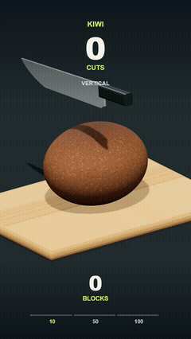

# 切割解压视频 Skill

用本地 3D 渲染制作竖屏 ASMR 切割视频。每一档从完整物体开始，先竖切，再横切，最后换方向竖切成块。刀数、碎块计数和刀声随画面同步。

## 演示

[](demo.mp4)

[查看完整演示 MP4](demo.mp4) · 19.6 秒，720 × 1280，有声。样片依次演示 10、50、100 刀。

## 用法

让 Codex 读取 [SKILL.md](SKILL.md)，告诉它物体、切刀档位和每档时长。例如「用这个 Skill 做一个猕猴桃切 10、50、100 刀的竖屏视频」。

支持猕猴桃、火龙果和肥皂三个内置预设。模型与音效在本地生成。水果块数来自三轴网格估算，高刀数时画面会降低碎块渲染密度。

### 命令行

Windows 需要 Node.js、FFmpeg 和 Chrome 或 Edge。首次安装渲染依赖：

```powershell
$renderDeps = Join-Path $env:LOCALAPPDATA 'guiji-cutting-renderer'
npm.cmd install --prefix $renderDeps --no-audit --no-fund --ignore-scripts --save-exact three@0.187.0 playwright-core@1.65.1
```

在仓库根目录用样片配置重新生成视频：

```powershell
node scripts/render.mjs kiwi.json kiwi.mp4
```

可调整的设置见 [Skill 文档](SKILL.md)。

